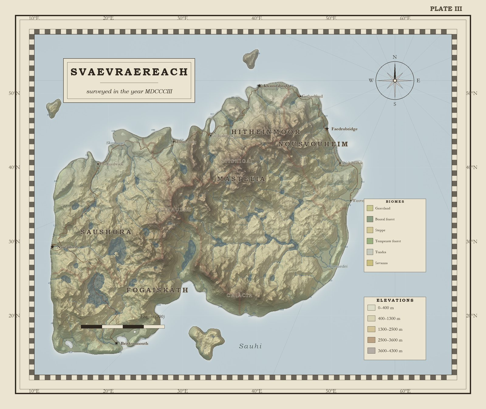
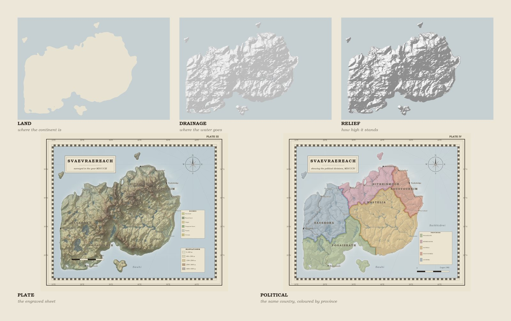

# Terra Ficta

**A deterministic procedural cartography engine.** Give it a seed; it gives you a
continent — terrain, drainage, climate, place names, and a finished sheet drawn in
the manner of a nineteenth-century relief atlas.

*Terra ficta* is what medieval mapmakers called country they had invented
themselves. The command is `atlas`; the package is `atlas`.



Nothing in the output is hand-drawn. Nothing is random in the sense of being
irreproducible: the same seed always produces the same world, down to the last
river bend and the last letter of the last town's name.

```bash
python -m atlas --seed 7
```

```
  seed     7  terrain  21.2s  ink  21.0s  3180x2280
  -> out/atlas_0007.png
```

The machine behind one sheet — land mask, drainage network, bare relief, and the
finished plate:



---

## What it produces

| | |
|---|---|
| **Terrain** | fractal landmass, orogenic belts, carved valley networks, lakes |
| **Water** | steepest-descent drainage, flow accumulation, rivers drawn tapered downstream |
| **Climate** | latitude and altitude temperature, orographic precipitation with rain shadows, Whittaker biomes, tinted into the lowlands and keyed in the legend |
| **Provinces** | grown from watersheds, so borders follow the divides; drawn as a dotted rule |
| **Roads** | a minimum spanning tree decides which towns connect, A\* over a terrain cost field decides where each road runs |
| **Names** | a small invented phonology per region, so names within a province sound related |
| **Framing** | the plate is cut to its subject: the largest landmass plus any island that mostly falls inside it, then a furniture solver finds open water for the cartouche, compass, keys and scale bar |
| **The physical sheet** | hypsometric tints, hillshade, jittered slope hachures drawn down the fall line, contours, coastal hachures, soundings, rhumb lines, graticule, graduated chequer border, compass, scale, two keys, cartouche, plate number |
| **The political sheet** | the same country flat-washed by province, boundaries drawn solid, a numbered key, and the relief dropped to a whisper |
| **The ancient sheet** | the same ground a century earlier: the borders redrawn from a different partition of the same watersheds, the provinces renamed, the pigments browned and the paper darkened, so the two sheets can be read side by side |
| **The climate sheet** | a thematic plate: annual rainfall in eight bands, its limits drawn as isohyets, the annual isotherms broken in red over them, and a key that states the numbers |
| **The line sheet** | the same ground drawn without a hillshade: contours carry the height, hachures run down every slope, and the colour is withdrawn to a wash, so the relief has to be read from the line work rather than from the light |
| **The dictionary** | one alphabetical entry per named place, set in two columns, every figure in it measured off the terrain: rank, population, elevation, distance inland, the river it stands on, the range it rises in, the sea it reaches |
| **The journey** | a route from the seat of government to the town furthest from any other, written up as a road book: where it crosses water, where it climbs, which province it enters, and how far it has come, every figure measured on the way |
| **The book** | title page, colophon, contents with dot leaders, numbered plates, a survey and a dictionary per country, an index of names whose folios point at the entries |

Output is a PNG at roughly 2700×2000, a bound PDF of forty-odd pages, and a
static viewer you can pan and zoom.

---

## Quick start

Requires Python 3.10+, `numpy` and `Pillow`. Nothing else.

```bash
# one sheet
python -m atlas --seed 7

# a bound book of six countries, each with a physical and a political plate
python -m atlas --seeds 1-6 --political --gallery --viewer --book out/atlas.pdf

# the same, plus every country as it stood a century earlier
python -m atlas --seeds 1-6 --political --ancient --gallery --viewer --book out/atlas.pdf

# the full book: four plates a country
python -m atlas --seeds 1-6 --political --ancient --climate --gallery --viewer --book out/atlas.pdf

# add the pure-line sheet to each country as well
python -m atlas --seeds 1-6 --political --ancient --climate --engraved \
    --gallery --viewer --book out/atlas.pdf

# smaller paper, faster iteration
python -m atlas --seed 7 --width 900 --height 600 --scale 2
```

| flag | meaning |
|---|---|
| `--seed` | which world |
| `--seeds` | a range (`1-8`) or a list (`3,7,11`) |
| `--width` / `--height` | terrain grid, in cells (default 1400×950) |
| `--scale` | output pixels per grid cell (default 2) |
| `--title` | override the invented country name |
| `--book` / `--pdf` | bind the results into one document |
| `--gallery` | write `index.html` beside the images |
| `--viewer` | write `viewer.html`: pan, zoom, read the gazetteer |

---

## How a world is made

The pipeline is ordered, and the order matters more than any single step.

```
landmass  →  drainage  →  carved valleys  →  fine detail  →  drainage again
```

**1. Landmass.** A branching spine of tapering segments is grown from a core, along
a common grain, and the land is everything within a varying distance of it — long
capes, bays between the arms, a width that falls towards the ends. The spine is then
displaced by domain-warped noise. Sea level is chosen by quantile, so the land
fraction is exactly what was asked for. Two things are kept strictly apart here: the
potential decides *where the land is*, and a separate relief field decides *how high
it is*. Conflating them yields the classic procedural-geography tell — a continent
that is a smooth dome.

**2. Drainage.** Closed basins are filled with a priority flood over a bucket
queue, then water is routed by steepest descent and accumulated by Kahn's
algorithm in vectorised layers.

**3. Valleys.** The drainage network is blurred at three scales and subtracted
from the terrain. Big rivers cut broad troughs, creeks cut notches. This replaced
an explicit stream-power erosion model, which is physically honest but, once
discretised on a raster with a stability clamp, converges to a staircase.

**4. Detail.** High-frequency ridges are added *after* routing. Put in earlier,
they shatter the network into thousands of competing puddles.

**5. Climate.** Latitude is drawn from the seed, so each country sits in its own
band — one is arctic, another Mediterranean. Temperature falls with latitude and
height; moisture is carried in from the west, lifted over ridges and dropped in
their rain shadow; a Whittaker classification turns the two into biomes.

**6. Ice.** A snowline falls from 5,200 m in the tropics to sea level at the pole.
Land above it is glacier; above 66.5 degrees the whole surface is a sheet. Sea ice
is drawn from a noise-warped margin, as a wash inside a dotted limit with a sparse
scatter of floes at the edge — because a straight edge of ice is the one thing an
arctic chart never shows, and a field of white shapes is camouflage, not ice.

**7. Names.** Each region draws from its own phonology — a distinct onset/vowel/
coda inventory — and its own set of toponymic suffixes. Labels are placed
greedily, measured with the font that will actually draw them.

**8. The sheet.** Layers are composited in ink order, then laid onto toned paper.

See [DESIGN.md](DESIGN.md) for the reasoning behind each choice, including the
ones that turned out to be wrong.

---

## Repository

```
atlas/
  config.py      WorldSpec — every dial that shapes a world
  noise.py       gradient noise, fBm, ridged multifractal, domain warping
  terrain.py     landmass, orogenic belts, fine detail
  hydro.py       depression filling, flow routing, accumulation, valley carving
  climate.py     temperature, orographic moisture, Whittaker biomes
  regions.py     provinces grown from watersheds
  roads.py       least-cost roads: spanning tree plus A*
  world.py       the pipeline, plus an on-disk cache
  shade.py       hillshade, curvature, ambient occlusion
  palette.py     inks and tints
  layout.py      framing: which window of the world, and where the furniture fits
  render.py      the drawing itself, physical and political
  decor.py       frame, graticule, compass, scale bar, cartouche, legend
  naming.py      invented phonologies and toponymy
  labels.py      feature extraction and label placement
  features.py    measuring the country: rivers, towns, ranges, provinces
  compose.py     the finished sheet
  gazetteer.py   prose, written from the measurements
  book.py        front matter, contents, index
  web.py         the static viewer
  cli.py         command line
tests/           the invariants the book depends on
tools/           development benches used while building this
out/             results
cache/           generated worlds, keyed by a hash of the spec
```

The cache is safe to delete. It exists so that re-inking a world does not mean
recomputing its rivers. It is keyed on every dial in `WorldSpec` that can change
the terrain, and on nothing that is merely presentation — so a new dial is
covered by default, and the worst a stale key can do is cost you a rebuild.

---

## Tests

```bash
python -m tests
```

No test framework, just a runner that finds `test_*` functions. What is checked
is not "does it run" but the claims the book makes about the world:

- the bucket-queue flood is **bit-identical** to a textbook heap flood, and the
  filled surface has no interior pit;
- a warm cache produces the same world as a cold one, array by array, and lays
  out the same labels;
- every province that is tinted on the plate is also named on it;
- every town speaks the language of the province it stands in;
- the river the prose calls longest is the one the measurement returns, printed
  with its measured length;
- a crop re-routes with its depressions filled, so no channel ends in mid-air;
- the title page counts plates, not countries, and the index never runs off the
  foot of the page.

---

## Determinism

Every random draw comes from a `numpy` generator seeded from the world seed, and
every noise field is a pure function of its coordinates. There is no global RNG
state and no dependence on iteration order in a hash map. Given the same seed and
the same version of this code, the output is byte-identical.

That property is the point. A map that cannot be reproduced is a drawing; a map
that can is a place.

---

## Status

Working: terrain, hydrology, climate and biomes, provinces, roads, relief
rendering, framing, furniture placement, typography, naming, physical and
political composition, book binding, gallery, viewer.

Still wrong, and known to be wrong:

- The far north now freezes, but the ice has no history: it does not advance or
  retreat, and no coastline is drawn as it would have looked during the Little
  Ice Age.
- The index gives one folio per name. A river that runs through three plates
  is listed once.
- Islands are lobed by construction, which is honest but monotonous: the
  harmonic sum is the same shape at every scale.
- Towns have exactly two ranks: a seat of government gets a star, everything
  else a dot. A real plate grades market towns, post towns, villages and
  ruins, and this one has no vocabulary for any of it.
- Region names are now compulsory, but on about one seed in six a province
  still finds nowhere to write: it is then tinted on the plate and missing from
  the key, which is the one inconsistency a reader will actually notice.
- The dictionary is thin. Every entry is a measurement — a rank, an elevation,
  a distance — and nothing else. There is no trade, no history, no reason for
  the town to be there. A real gazetteer entry has a *why*.
- The scale is now honest, and that is the newest thing in the book: a country
  spans sixteen degrees of latitude, about seventeen hundred kilometres, so a
  river is 800 km long, a market town holds 11,000 people and its neighbour
  stands 110 km away. Density is still the weak point: forty-two towns and
  forty hamlets a country, drawn with three symbols and a leader line where a
  name had to move, where a real sheet at this scale would carry several
  hundred named places and a graduated vocabulary of what each one is.
- Nothing in the book is written by a person, including the colophon, which is
  the one place a person ought to be speaking.
